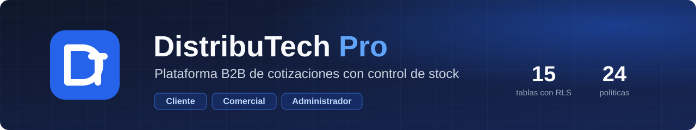
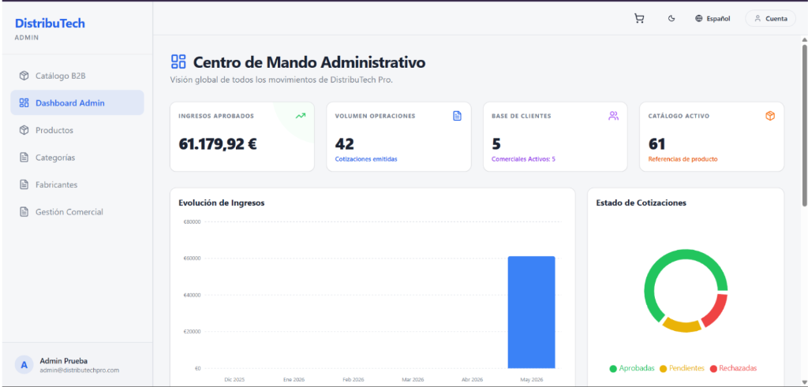
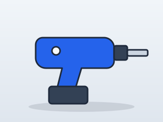
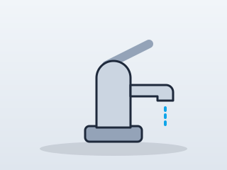
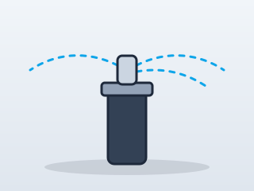
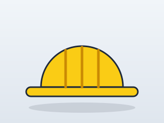
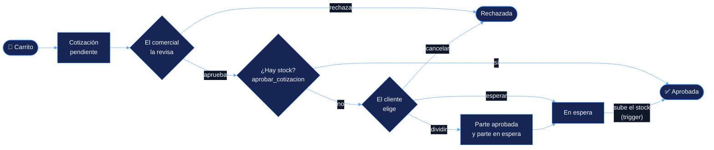

<p align="center">
  
</p>

<p align="center">
  <a href="https://github.com/robertorayo/DistribuTech-Pro/actions/workflows/ci.yml"></a>
  <a href="https://react.dev/"></a>
  <a href="https://www.typescriptlang.org/"></a>
  <a href="https://vitejs.dev/"></a>
  <a href="https://tailwindcss.com/"></a>
  <a href="https://supabase.com/"></a>
  
</p>

<p align="center">
  <a href="https://distributech-pro.vercel.app"></a>
</p>

Plataforma B2B de cotizaciones para un distribuidor de material técnico (ferretería, fontanería, riego, baño e industrial). Los clientes arman un carrito y lo envían como cotización, los comerciales la revisan y la aprueban comprobando el stock, y el administrador gestiona el catálogo y ve el estado del negocio.

<p align="center">
  
  <br><sub>Panel de administración</sub>
</p>

## Probar la demo

Es un entorno público con cuentas de prueba. Cada enlace abre el acceso con los datos ya escritos; solo hay que pulsar «Iniciar sesión».

| Rol | Entrar | Correo | Contraseña |
| --- | --- | --- | --- |
| 🛒 Cliente | [abrir](https://distributech-pro.vercel.app/login?demo=cliente) | `cliente@distributechpro.com` | `Cliente1324!` |
| 💼 Comercial | [abrir](https://distributech-pro.vercel.app/login?demo=comercial) | `comercial1@distributechpro.com` | `Comercial1234!` |
| 🛠️ Administrador | [abrir](https://distributech-pro.vercel.app/login?demo=admin) | `admin@distributechpro.com` | `Admin1234!` |

> [!NOTE]
> Los datos los comparte cualquiera que use la demo, así que pueden haber cambiado.

## Qué hace

<table>
  <tr>
    <td width="50%" valign="top">
      <h4>📦 Catálogo</h4>
      Búsqueda por texto, filtros por categoría y fabricante, ordenación, paginación y ficha de producto con especificaciones técnicas en <code>JSONB</code>. Cada producto se muestra con una ilustración propia en SVG (<code>public/productos/</code>), elegida según el tipo de producto o su categoría; no se usan fotos de marcas.
    </td>
    <td width="50%" valign="top">
      <h4>🛒 Carrito y cotización</h4>
      El carrito se guarda en el navegador (Zustand con persistencia) y limita las cantidades al stock disponible. Al enviarlo se crea una cotización.
    </td>
  </tr>
  <tr>
    <td valign="top">
      <h4>💼 Revisión comercial</h4>
      Panel con la cartera de clientes y las cotizaciones entrantes, con filtros, búsqueda y detalle. El comercial aprueba o rechaza.
    </td>
    <td valign="top">
      <h4>📊 Administración</h4>
      CRUD de productos, categorías y fabricantes (con desactivación en lugar de borrado) y panel con gráficas de ingresos y reparto de cotizaciones por estado, filtrable por mes y año.
    </td>
  </tr>
  <tr>
    <td colspan="2" valign="top">
      <h4>👤 Cuenta</h4>
      Registro, recuperación de contraseña, perfil, modo claro y oscuro, interfaz en español e inglés (el idioma elegido se recuerda) y sesión única por usuario. En las cuentas de la demo la interfaz no permite cambiar el correo ni la contraseña.
    </td>
  </tr>
</table>

<p align="center">
  
  
  
  
  
  
  <br><sub>Algunas de las ilustraciones del catálogo (<code>public/productos/</code>)</sub>
</p>

### Control de stock al aprobar

La aprobación se hace en la base de datos y comprueba el stock de forma atómica. Si falta stock, el cliente puede dividir la cotización (una parte aprobada y otra en espera), esperar a tener el pedido completo o cancelar. Cuando sube el stock de un producto, un trigger procesa automáticamente las cotizaciones en espera por orden de llegada.



## Roles

| Zona | 🛒 Cliente | 💼 Comercial | 🛠️ Administrador |
| --- | :---: | :---: | :---: |
| Catálogo, carrito y perfil | ✅ | ✅ | ✅ |
| Mis cotizaciones y pedidos | ✅ | — | — |
| Panel comercial y revisión de cotizaciones | — | ✅ | ✅ |
| Gestión de productos, categorías y fabricantes | — | ✅ | ✅ |
| Panel de administración con métricas | — | — | ✅ |

El acceso a cada ruta se controla en el cliente con `PrivateRoute`, y los datos, en la base de datos con RLS.

## Stack

| Parte | Tecnologías |
| --- | --- |
| **Frontend** | React 18, TypeScript, Vite, React Router 6, Tailwind CSS, componentes de shadcn/ui y Base UI, Zustand, Recharts, Sonner e i18next |
| **Backend** | Supabase, es decir, PostgreSQL con Row Level Security, funciones RPC y triggers, más Supabase Auth. No hay servidor propio |
| **Despliegue** | Vercel, con una regla de reescritura para la SPA (`vercel.json`) |

## Base de datos

El esquema completo está en [`database/schema.sql`](database/schema.sql): 15 tablas con RLS activado, 24 políticas, funciones, triggers e índices, incluido uno de búsqueda de texto completo en español sobre los productos. Los datos de ejemplo (categorías, fabricantes y productos) están en [`database/data.sql`](database/data.sql); los fabricantes son ficticios.

Tablas principales: `usuarios` (extiende `auth.users` con rol, empresa y datos de contacto), `empresas`, `categorias`, `fabricantes`, `productos` (con `especificaciones_tecnicas JSONB`), `cotizaciones` con `detalle_cotizacion`, y `pedidos` con `detalle_pedido`, `pedido_historial_estados` y `facturas`.

## 🔒 Seguridad

Los permisos se aplican en PostgreSQL, no solo en la interfaz: aunque alguien se salte la aplicación y consulte la API directamente, cada rol solo ve lo suyo.

```sql
-- el cliente solo ve sus cotizaciones; el personal (admin/comercial) ve todas
CREATE POLICY "user_leer_cot" ON cotizaciones FOR SELECT USING (
  usuario_id = auth.uid() OR get_my_rol() IN ('admin', 'comercial')
);
```

- `get_my_rol()` lee el rol real desde la tabla `usuarios`, no desde datos que el cliente pueda manipular.
- La aprobación, la división y la espera de cotizaciones son funciones `SECURITY DEFINER` que comprueban el rol antes de actuar.
- Un trigger (`handle_new_user`) crea la fila de `usuarios` al registrarse alguien en Supabase Auth.
- `registrar_actividad_sesion()` impone una sola sesión activa por usuario; las cuentas de la demo pública están exentas.
- Triggers que impiden a un cliente fijar precios, descuentos o estados de sus cotizaciones desde la API: el precio y el IVA de cada línea salen del catálogo y solo puede cancelar una cotización pendiente.
- Las cuentas de la demo pública no pueden borrar el catálogo ni cambiar el correo, la contraseña, el rol o el estado de ninguna cuenta demo; sí pueden crear y editar.
- Registro de auditoría: un trigger guarda en la tabla `auditoria` quién cambió qué en productos, categorías, fabricantes, usuarios y cotizaciones, con el valor anterior y el nuevo. Solo lo lee el administrador y nadie puede editarlo ni borrarlo desde la API.
- La clave que usa el navegador es la `anon`; la protección real está en las políticas RLS.
- `vercel.json` añade cabeceras de seguridad: Content-Security-Policy (solo scripts propios y conexiones a Supabase), HSTS, `X-Frame-Options`, `X-Content-Type-Options`, `Referrer-Policy` y `Permissions-Policy`.

## Estructura

```
src/
├── components/   Layout, rutas protegidas y componentes compartidos (tabla, filtros, paginación…)
│   ├── shared/
│   └── ui/       primitivas de shadcn/ui
├── context/      sesión (AuthContext) y tema
├── lib/          cliente de Supabase, formateadores y utilidades
├── pages/        una pantalla por ruta (catálogo, checkout, paneles, CRUD, login…)
├── store/        carrito (Zustand)
├── types/        tipos del modelo de datos
└── i18n.ts       traducciones en español e inglés
database/         schema.sql, data.sql y migrations/ (cambios aplicados sobre el esquema)
docs/             manuales de usuario, técnico y de despliegue (PDF) e imágenes del README
```

## Puesta en marcha

Requisitos: Node.js 18 o superior y un proyecto de Supabase.

```bash
git clone https://github.com/robertorayo/DistribuTech-Pro.git
cd DistribuTech-Pro
npm install
cp .env.example .env     # rellena VITE_SUPABASE_URL y VITE_SUPABASE_ANON_KEY
```

1. En el *SQL Editor* de Supabase ejecuta `database/schema.sql` y después `database/data.sql`.
2. Crea los usuarios en *Authentication → Users*. El trigger genera su fila en `usuarios` con rol `cliente`; para dar otro rol:
   ```sql
   update usuarios set rol = 'admin' where email = 'tu@correo.com';
   ```
3. Arranca la aplicación:
   ```bash
   npm run dev
   ```
   Se abre en `http://localhost:5173`. Para generar la versión de producción: `npm run build`.

## Tests y CI

Los tests usan Vitest y Testing Library sobre jsdom. Supabase se simula, así que no necesitan `.env` ni conexión.

```bash
npm test             # ejecuta todos los tests una vez
npm run test:watch   # los repite al guardar cambios
npm run lint         # ESLint
```

Cubren el carrito (`store/cartStore.ts`), los formateadores de precio y fecha en los dos idiomas, la utilidad `cn`, la elección de ilustración de cada producto (todos los de `data.sql` tienen una propia), la detección de cuentas demo, la paginación, el control de acceso por rol de `PrivateRoute` y la pantalla de checkout (base imponible, IVA según el tipo de cada producto y total, límite de stock y creación de la cotización con su detalle).

En cada push y pull request a `develop` y `main`, GitHub Actions ([`.github/workflows/ci.yml`](.github/workflows/ci.yml)) instala las dependencias con `npm ci` y ejecuta el lint, los tests y el build.

## Licencia y autoría

Desarrollado por Roberto Borrallo Álvarez. Presentado originalmente como proyecto final del ciclo superior de Desarrollo de Aplicaciones Web.
